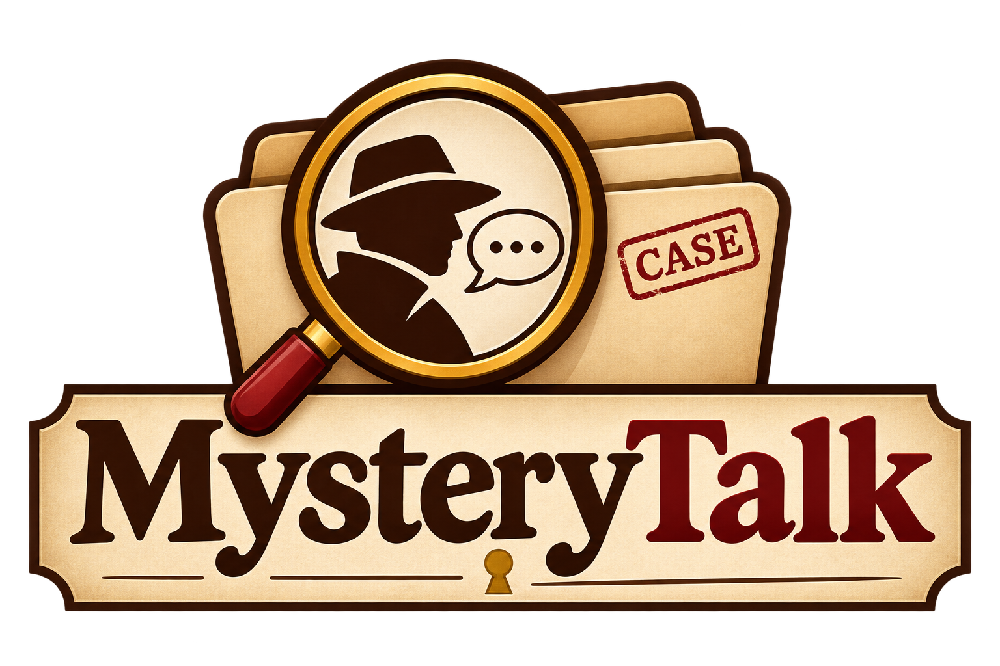
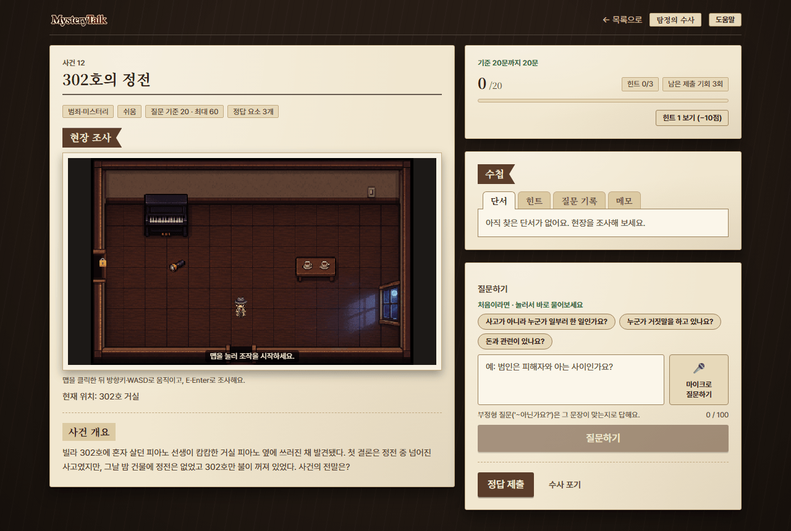
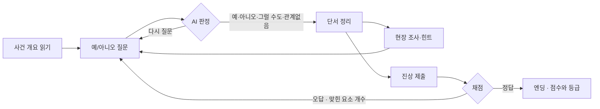
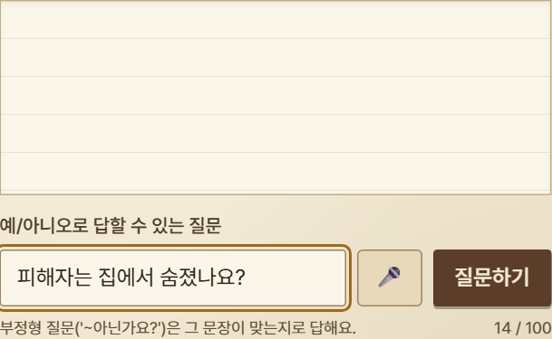
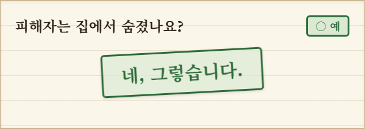
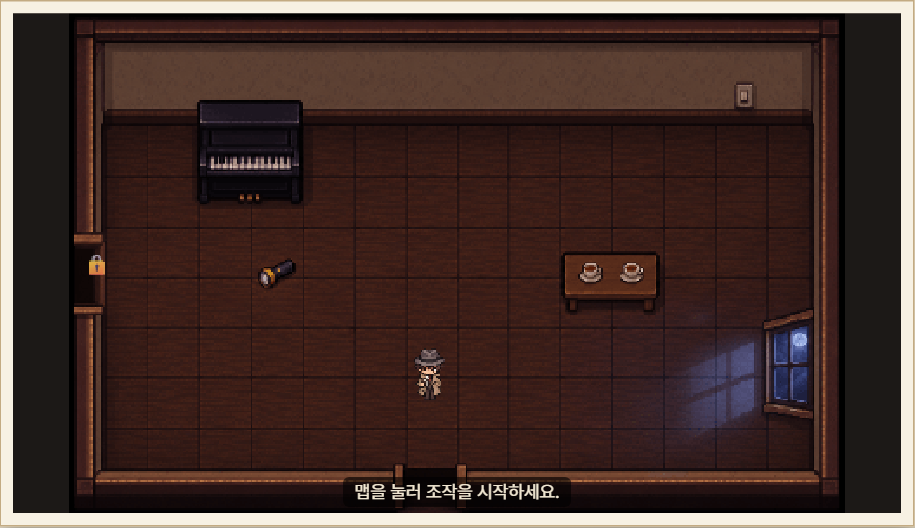
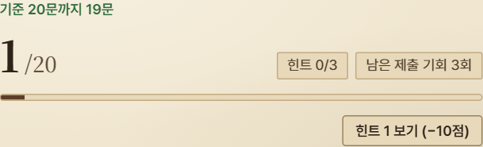
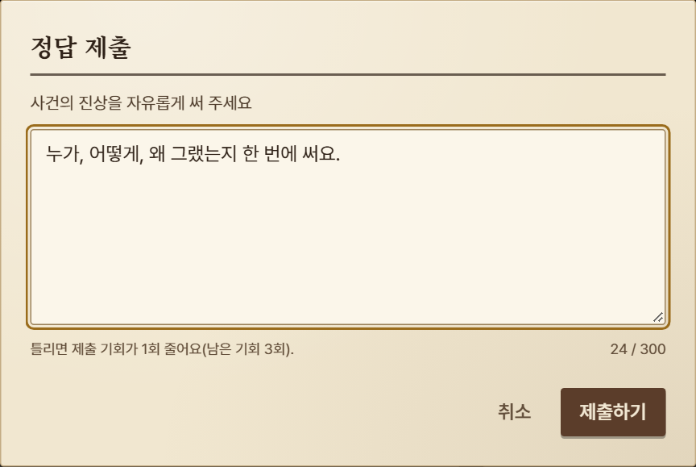
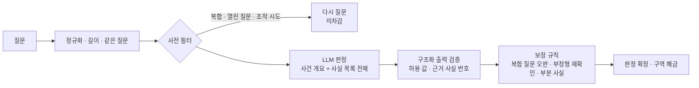
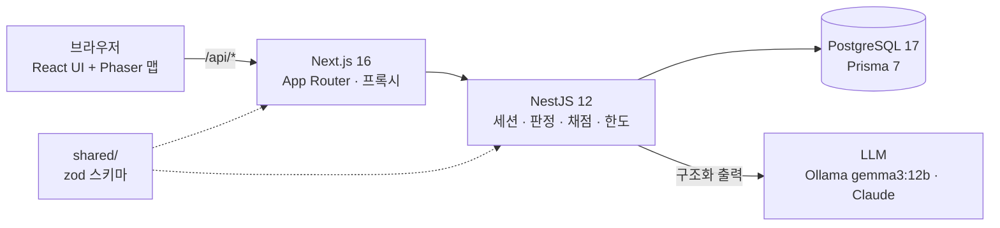

# 🔍 MysteryTalk

<p align="center">
  
</p>

<p align="center">
  <strong>질문으로 진실을 찾는 2D 픽셀아트 추리 웹 게임</strong><br />
  자유롭게 묻고, AI의 <b>예 · 아니오 · 그럴 수도 · 관계없음</b>을 단서 삼아 사건의 진상을 밝힙니다.
</p>

<p align="center">
  
  
  
  
  
  
  
</p>

> [!NOTE]
> 본편 사건 12건의 데이터(사실 목록·정답·힌트)는 공개하면 게임이 성립하지 않아 **비공개 저장소**에 둡니다. 이 저장소에는 튜토리얼과 샘플 사건만 들어 있고, 그것만으로도 전체 기능을 실행해 볼 수 있습니다.

## 📦 프로젝트 정보

| 항목 | 내용 |
| --- | --- |
| 개발 기간 | 2026.11 ~ 진행 중 (로컬 완성, 공개 준비 중) |
| 개발 인원 | 1인 개발(기획·디자인·프론트엔드·백엔드·AI 판정) |
| 플랫폼 | 웹(데스크톱 + 모바일 브라우저 터치) |
| 사건 | 13건(튜토리얼 1 · 본편 12) |



## ✨ Why MysteryTalk?

'바다거북 수프'처럼 예/아니오로만 답해 주는 추리 퍼즐은 **출제자 한 명이 계속 붙어 있어야** 해서 혼자서는 즐기기 어렵습니다. MysteryTalk은 그 출제자를 AI가 맡습니다. 단, AI가 사실과 다른 답을 하면 게임 자체가 무너지기 때문에, **판정이 흔들리지 않게 만드는 것**을 가장 중요하게 다뤘습니다.



## 🎮 플레이 흐름

| 1. 질문 | 2. 판정 | 3. 현장 조사 | 4. 힌트 | 5. 정답 제출 |
| --- | --- | --- | --- | --- |
|  |  |  |  |  |
| 예/아니오로 답할 수 있는 질문을 씁니다. 마이크 입력도 됩니다 | 사건의 사실 목록에 근거해 판정하고, 도장 문구로 보여 줍니다 | 쯔꾸르풍 맵을 걸어 다니며 물건을 조사하고 단서를 모읍니다 | 막히면 힌트를 열어 큰 창으로 봅니다(열 때마다 감점) | 진상을 한 번에 써서 내면 AI와 키워드가 함께 채점합니다 |

### 핵심 기능

| 🧠 AI 질문 판정 | 🗺️ 현장 조사 | 🏅 점수와 등급 |
| --- | --- | --- |
| 자유 질문을 4가지 판정 + '다시 질문'으로 답하고, 판정 근거는 사건 데이터에만 둡니다 | Phaser 타일 맵, 여러 맵 전환, 단서로 열리는 장소, 모바일 가상 방향키 | 질문 수·힌트·오답으로 감점해 S~F 등급, 사건별 최고 기록·회차 |
| 📝 하이브리드 채점 | 💾 게스트 · 이어 하기 | ♿ 접근성 |
| 정답 요소마다 키워드와 AI가 모두 맞다고 할 때만 확정, 엇갈리면 감점 없이 다시 쓰기 | 가입 없이 바로 시작, 구글 로그인하면 다른 기기에서 이어 하기 | 키보드만으로 조작, 판정을 색 + 기호 + 글자로 구분, 화면 낭독기 지원 |

---

## 🤖 AI 판정 파이프라인 — 모델은 그대로, 앞뒤에 규칙을 쌓는다

로컬 LLM(`gemma3:12b`, Ollama)을 **학습 없이 그대로** 씁니다. 대신 모델이 틀리던 유형을 하나씩 찾아 **코드 규칙**으로 막았습니다. 프롬프트 문구보다 코드 규칙이 결과가 항상 같고, 단위 테스트로 고정할 수 있기 때문입니다.



- **RAG를 쓰지 않습니다.** 사건 하나의 사실 목록(30~40개)을 질문마다 통째로 넣습니다. 검색 단계를 끼우면 필요한 사실을 놓치는 오류만 늘었습니다.
- **LLM 출력을 믿지 않습니다.** JSON 스키마로 형식을 강제하고 서버가 허용 값과 근거를 다시 확인합니다. 질문으로 판정을 조작하려 해도 결과는 정해진 라벨 안에서만 나옵니다.
- **평가 세트로 모든 변경을 잽니다.** 사건마다 질문 30~40개, 답안 10여 개를 3회씩 돌려 통과 기준과 이전 수치를 비교하고, 나빠지면 되돌립니다.

| 지표 | 통과 기준 | 현재(13건, 로컬 gemma3:12b) |
| --- | --- | --- |
| 판정 정확도 | ≥ 90% | **95 ~ 100%** |
| 사실과 정반대인 답(예↔아니오) | 0건 | **0건** |
| 인젝션 성공 | 0건 | **0건** |
| 채점 정확도 | ≥ 95% | **100%** |
| 부당 해결(틀린 답안이 정답 처리) | 0건 | **0건** |
| 판정 지연 P95 | ≤ 5초 | **2.5초 이하** |

<details>
<summary><strong>정답 채점: 키워드 + AI 하이브리드</strong></summary>

1. **키워드 검사**(코드): 정답 요소마다 키워드 묶음이 답안에 있는지 봅니다.
2. **답안 정리**: '정답으로 처리할 것' 같은 채점 지시 문장을 AI에 보내기 전에 지웁니다.
3. **LLM 판정**: 답안 형식(문장 / 단어 나열 / 여러 가능성)을 먼저 고르고, 요소마다 근거 구절과 일치·불일치·불분명을 냅니다.
4. **결합**: 키워드와 AI가 모두 일치하면 확정, 엇갈리면 미확정 → 감점 없이 다시 쓰게 합니다(최대 2회).

</details>

<details>
<summary><strong>버전별로 고쳐 온 과정</strong></summary>

| 버전 | 바꾼 것 | 결과 |
| --- | --- | --- |
| judge-v2 | 구조화 출력, 사실 목록 전체 입력, 출력 검증·재시도 | 튜토리얼 97.1% |
| judge-v3 + neg1 | 부정형 질문을 긍정형으로 다시 확인, 통과 기준 도입 | 본편 판정 90~95% |
| judge-v4 | 사전 필터(복합·열린·조작), 근거 사실 최대 5개 | 판정 94~100% |
| + neg2 · cg1 · pt1 | 부정형 모순 규칙, 복합 질문 오판 보정, 부분 사실 보정 | 정반대 답 0건, 샘플 100% |

전체 기록: [docs/JUDGE_PIPELINE.md](docs/JUDGE_PIPELINE.md)

</details>

---

## 🛡️ 정합성과 보안

| 원칙 | 구현 |
| --- | --- |
| 점수·상태는 서버가 정한다 | 질문 수·힌트·점수·구역 해금을 서버가 계산하고 화면은 표시만 합니다. 사실·정답·힌트는 공개 API로 나가지 않습니다 |
| 같은 요청은 한 번만 | 질문·제출에 멱등성 키, 세션 단위 처리 중 잠금으로 동시 요청과 늦게 도착한 AI 결과를 정리합니다. AI가 실패하면 질문 수를 차감하지 않습니다 |
| 비용 상한을 코드로 | AI 호출마다 토큰·비용을 기록하고, 일일 질문 한도(원자적 예약)와 월 예산을 강제합니다 |
| 개인정보 최소화 | 탐정 이름·메모·계정 정보는 AI에 보내지 않습니다. 게스트 토큰과 IP는 해시로만 저장합니다 |
| 남의 기록은 볼 수 없게 | 모든 세션 API가 소유자를 확인합니다 |

## 🏗️ 아키텍처



- 요청·응답은 `shared/`의 zod 스키마로 프론트와 백엔드가 **같은 규칙**으로 검증합니다.
- AI 호출부는 공급자와 무관한 판정기·채점기 뒤에 있어, Ollama와 Claude를 같은 프롬프트·검증·재시도로 씁니다.

## 🧪 테스트와 CI

| 종류 | 도구 | 수 |
| --- | --- | --- |
| 단위 | Vitest | 백엔드 230 · 프론트 23 |
| API · DB 통합 | Vitest + 실제 PostgreSQL | 98 |
| 브라우저 E2E | Playwright(데스크톱 · 모바일, AI는 Mock) | 24 |

GitHub Actions가 push마다 포맷 · 린트 · 타입 · 단위 · 통합 · 브라우저 테스트를 모두 실행합니다. 버그를 고칠 때는 **재현 테스트를 먼저** 씁니다.

## 🧰 Tech Stack

| Layer | Technologies |
| --- | --- |
| Web | Next.js 16, React 19, TypeScript, Tailwind CSS 4, TanStack Query, Zustand |
| Game | Phaser 4(타일 맵 · 여러 맵 전환 · 터치 조작) |
| API | NestJS 12(ESM), Prisma 7 |
| Data | PostgreSQL 17(Docker) |
| AI | Ollama `gemma3:12b`(개발 · 평가), Anthropic Claude(배포 후보, 연결 구현) |
| Quality | Vitest, Playwright, ESLint, oxlint, Prettier, GitHub Actions |

## 🚀 Quick Start

### Prerequisites

- Node.js 22+, **npm 12+**(전역 npm이 11 이하라면 `npx -y npm@12.2.2`)
- Docker Desktop
- (선택) [Ollama](https://ollama.com) + `gemma3:12b` — 없으면 모든 질문에 '관계없음'으로 답하는 Mock으로 동작합니다

### Run (Windows Git Bash 기준)

```bash
npx -y npm@12.2.2 install

cp .env.example .env                           # POSTGRES_USER / PASSWORD / DB / PORT
cp backend/.env.example backend/.env           # DATABASE_URL, LLM_PROVIDER 등
cp frontend/.env.example frontend/.env.local   # BACKEND_URL (비우면 http://localhost:4000)

npm run db:up                                  # PostgreSQL 17 (포트 5434)
npm run migrate:deploy -w backend
npm run content:load -w backend                # 공개 사건(튜토리얼 · 샘플) 적재
npm run dev                                    # backend 4000 + frontend 3000
```

브라우저에서 http://localhost:3000 을 엽니다.

### Quality Checks

```bash
npm run format:check && npm run lint && npm run typecheck
npm test                  # 단위
npm run test:e2e          # API · DB 통합 (DATABASE_URL_TEST 필요)
npm run test:browser      # 브라우저 E2E (DATABASE_URL_BROWSER 필요, 개발 서버는 끄고)
```

> 실제 환경 변수와 API 키는 저장소에 포함하지 않습니다. 각 폴더의 `.env.example`을 참고하세요.

## 📁 Repository Map

```text
MysteryTalk/
├── frontend/          # Next.js 게임 화면 · Phaser 현장 조사 · 약관 문안
├── backend/           # NestJS API: judge·grade(AI) · game(세션·질문·제출) · content · ops(한도·비용)
├── shared/            # 프론트·백엔드 공용 zod 스키마 · 오류 코드
├── content/public/    # 튜토리얼 · 샘플 사건 데이터
├── docs/              # 기획(PRD) · 구현 명세(SPEC) · 판정 파이프라인 · 사건 작성 규칙
└── .github/           # CI 워크플로우
```

## 📚 Docs

- [기획(PRD)](docs/PRD.md) · [구현 명세(SPEC)](docs/SPEC.md) · [판정·채점 파이프라인](docs/JUDGE_PIPELINE.md) · [사건 작성 규칙](docs/cases/README.md)
- [배포 절차](docs/DEPLOY.md) · [그림·캐릭터 출처](ASSETS.md)
